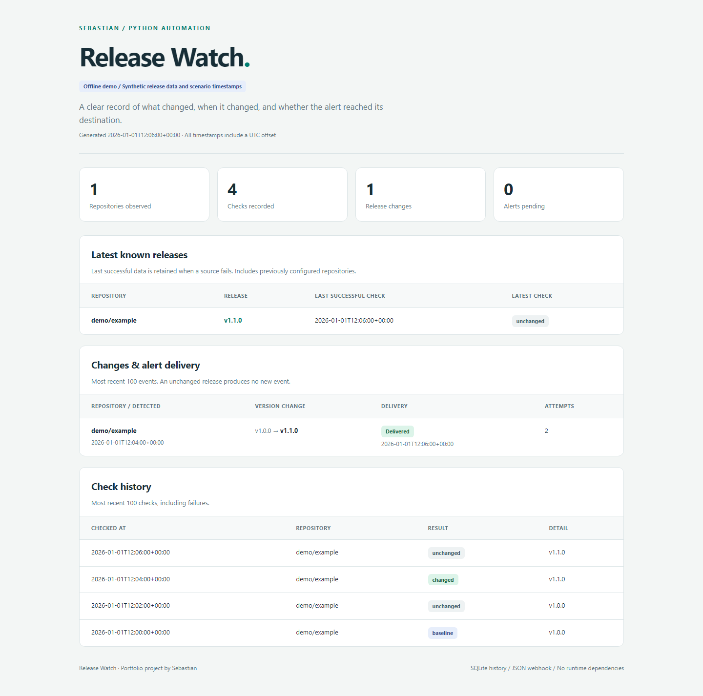

# Release Watch

**Python automation portfolio project by Sebastian.**

Monitor public GitHub releases, record changes in SQLite, generate a clean HTML report,
and deliver reliable JSON webhook alerts. A small, inspectable automation with a
real API integration and an offline demo that deliberately exercises a delivery failure.

**Python 3.11+ · Standard library runtime · Windows / Linux · SQLite · Webhooks**



## What a client gets

Instead of manually checking software vendors for new releases, a scheduled job
checks selected repositories and keeps an auditable history. A version change
creates one event. If the notification endpoint is unavailable, the event remains
queued and a later run retries it.

This project demonstrates API integration, data validation, stateful change
detection, reporting, error handling, scheduling and alert delivery. It is a portfolio
demonstration, not a claim of an existing client deployment.

## See it in one minute

From the project directory:

```console
python -m release_watch demo
```

Open `demo-output/report.html` in a browser. No account, API token, third-party
package or internet connection is needed. The demo binds a temporary HTTP server
to `127.0.0.1`, sends actual HTTP requests and shuts it down when finished.

```text
1. Establish baseline | changed=0 delivered=0 pending=0
2. Same release: no duplicate | changed=0 delivered=0 pending=0
3. New release: receiver returns 503 | changed=1 delivered=0 pending=1
4. Retry queued alert: receiver accepts | changed=0 delivered=1 pending=0
```

The warning about HTTP 503 is intentional. `demo` exits successfully after the
scenario completes. Its data and timestamps are synthetic; event IDs and the local
port are generated per execution. For another run, choose a new directory:

```console
python -m release_watch demo --output demo-output-2
```

Included examples: [completed report](examples/demo/report.html),
[pending alert before retry](examples/demo/report-before-retry.html),
[HTTP receipts](examples/demo/webhook-receipts.json),
[live API sample](examples/live/report.html).
Read the [90-second presentation script](docs/DEMO.md) and
[verification record](docs/VERIFICATION.md) for the evidence and its limits.

## Monitor real releases

No installation is required when running from the source directory:

```console
python -m release_watch run --config config.example.toml
```

The example checks `psf/requests` and `pallets/flask`. It writes
`data/state.sqlite3`, `reports/report.html` and `reports/report.json`.
The initial successful check establishes a baseline without sending an alert.
Subsequent identical releases produce no new event.

Copy `config.example.toml` to `config.toml` to customize the repositories and paths.
Paths are resolved relative to the configuration file, so a scheduler can use an
absolute config path from any working directory. Repository names are normalized
and deduplicated. Unknown configuration keys are rejected to catch typos.

Optional isolated installation (PowerShell):

```powershell
python -m venv .venv
.\.venv\Scripts\python.exe -m pip install .
.\.venv\Scripts\release-watch.exe --help
```

On Linux, the corresponding executables are `.venv/bin/python` and
`.venv/bin/release-watch`. Installation downloads the build tool; the application
itself has no third-party runtime dependencies. Running directly from source and
running tests require no downloads.

## Connect an alert receiver

Set `RELEASE_WATCH_WEBHOOK_URL` in the environment of the process running the job.
It must point to an HTTPS endpoint you control that accepts this project's JSON
contract. HTTP is permitted only for local loopback tests. Secrets are read from
environment variables; `.env` files are not loaded automatically.

Example configuration in PowerShell (replace the sample URL before running):

```powershell
$env:RELEASE_WATCH_WEBHOOK_URL = "https://your-receiver.example/releases"
python -m release_watch run --config config.toml
```

An optional `GITHUB_TOKEN` can authenticate reads. Public repositories also work
without authentication. Do not put credentials into the configuration or source.
Redirects are refused for both source requests and webhook delivery.

The receiver gets `Content-Type: application/json` and an `Idempotency-Key` header
equal to the persistent `event_id`:

```json
{
  "schema_version": 1,
  "event_id": "stable-uuid-across-retries",
  "event": "release.changed",
  "repository": "owner/project",
  "detected_at": "2026-01-01T12:00:00+00:00",
  "previous": {
    "release_id": 1,
    "tag": "v1.0.0",
    "name": "Release 1",
    "url": "https://github.com/owner/project/releases/tag/v1.0.0",
    "published_at": "2025-12-01T12:00:00Z"
  },
  "current": {
    "release_id": 2,
    "tag": "v1.1.0",
    "name": "Release 2",
    "url": "https://github.com/owner/project/releases/tag/v1.1.0",
    "published_at": "2026-01-01T11:00:00Z"
  }
}
```

Any HTTP 2xx response acknowledges delivery. Other responses and network errors
retain the event, with retry eligibility after 60, 120, 240 seconds and so on,
capped at one hour. Delivery happens only when `run` executes; there is no sleeping
background worker. With a 15-minute schedule, a 60-second retry becomes eligible
at the next 15-minute run. Up to 100 due events are attempted per run.

Delivery is **at least once**: a crash after receiver acceptance but before local
acknowledgement can cause a retry. The receiver should deduplicate on `event_id`.
Persistent 4xx responses also remain queued; fix the destination or credentials.
There is no dead-letter queue or automatic event expiry in this small project.

Without a webhook, monitoring and reports still work; events remain visibly pending
and the log explains that delivery is disabled. Adding a webhook later sends due
historical events as well. Changing the webhook redirects all pending events to the
new configured destination. This is a generic JSON webhook, not a native Slack,
Discord, Telegram or email integration; those require a small adapter or workflow.

## Run on a schedule

The command runs once and exits. The OS owns the schedule and captures the exit code.

**Windows Task Scheduler**: create a task repeating every 15 minutes, with the program
set to the absolute path of `.venv\Scripts\python.exe`, and arguments:

```text
-m release_watch run --config "C:\Automation\release-watch\config.toml"
```

Set **Start in** to the project directory. Choose **Do not start a new instance** if
the task is already running. Set environment variables for the account running the
task; variables assigned in an interactive PowerShell session are not automatically
available to scheduled tasks. No task is installed by this repository.

**Linux cron**, after installing the package in its virtual environment:

```cron
*/15 * * * * /opt/release-watch/.venv/bin/python -m release_watch run --config /opt/release-watch/config.toml >> /opt/release-watch/monitor.log 2>&1
```

Provision secrets for the scheduler account, and rotate the log. Start with a small
number of repositories and a conservative interval. Unauthenticated GitHub REST
requests share an IP-based quota; see the official
[rate-limit documentation](https://docs.github.com/en/rest/using-the-rest-api/rate-limits-for-the-rest-api).
This client stops immediate retries on HTTP 403/429 and leaves another attempt to
the next scheduled run. It does not implement a persistent rate-limit reset timer.

Exit codes: `0` completed without a source/delivery error (delivery may be disabled
or pending backoff); `1` one or more source/delivery failures occurred; `2` invalid
configuration, local storage/report error, overlapping run or invalid demo directory;
`130` user interruption. Inspect pending counts and report freshness as well as the
exit code. A job that never runs cannot report its own failure.

## Small architecture, explicit responsibilities

```text
OS scheduler -> CLI + run lock -> monitor
                                  |-> API client -> validated release
                                  |-> SQLite -> snapshot + checks + event outbox
                                  |-> webhook sender -> delivery acknowledgement
                                  `-> HTML + JSON report
```

| Module | Responsibility |
| --- | --- |
| `config.py` | Validate TOML, resolve paths and read environment secrets |
| `api.py` | Fetch and validate the public release projection |
| `store.py` | Persist observations and event delivery state transactionally |
| `alerts.py` | Send one JSON webhook attempt |
| `monitor.py` | Coordinate one run and retry due events |
| `report.py` | Escape report content and atomically replace output files |
| `locking.py` | Prevent concurrent command runs against one database |
| `demo.py` | Demonstrate success, failure and recovery over loopback HTTP |
| `cli.py` | Commands, logging and process exit codes |

The lock is released by the OS after a crash; the harmless `.lock` file can remain.
SQLite commits the new snapshot, check and outbox event in the same transaction.
A source failure adds an error check and leaves the previous successful snapshot
intact. Other repositories and older pending alerts are still processed.

## Tests and report generation

```console
python -m unittest discover -s tests -v
python -m release_watch report --config config.example.toml
```

Tests use temporary databases and local HTTP servers, including rollback on a forced
write failure, restart persistence, duplicate suppression, transient errors, rate
limits, secret-safe error output, HTML escaping, cross-process locking and webhook
recovery. They do not depend on GitHub or send external notifications.

The included GitHub Actions workflow runs the suite on Windows/Linux and Python
3.11/3.14 after publication. Its presence does not imply that remote CI has run.

`report` rebuilds the report without source or webhook requests. It writes an empty
report if no database exists yet. Reports show the latest 100 checks and events,
with all-time counters; the database retains the full history. Both files are
individually replaced atomically, but the HTML/JSON pair is not one transaction.
If generation fails, committed observations and events remain recoverable.

## Deliberate scope and operating notes

- Uses GitHub's [latest stable release endpoint](https://docs.github.com/en/rest/releases/releases#get-the-latest-release).
  A changed release ID or tag creates an event, including a rollback to an older
  release. Title-only edits update the snapshot without alerting. This is not a
  semantic-version comparator and does not monitor prereleases or bare Git tags.
- Polling the latest endpoint may miss intermediate releases between runs. A 404
  is recorded as a source error, not deletion or a blank baseline.
- The application has one local database and one configured webhook. Use a local
  disk; network filesystem locking is not supported. No distributed workers,
  multi-tenant accounts, dashboard server or custom scheduler.
- Removing a repository from configuration stops polling it but retains its
  history and pending alerts. Reports include that retained history.
- Logs contain event IDs and safe status descriptions, never source response bodies,
  webhook URLs or tokens. HTML escapes external text and loads no external assets.
  Source bodies are capped at 2 MB. HTTP reads have configured socket timeouts;
  this is not a strict total wall-clock deadline for a slow streaming peer.
- Reports and SQLite contain monitored repository names and release data. This
  project is intended for public repositories. Review artifacts before sharing
  if you adapt it to private sources.
- History retention and log rotation are operator responsibilities. Back up SQLite
  with its backup API, or stop all writers and copy the database together with any
  existing WAL sidecar. Do not delete a live database to clear an alert queue.

## Portfolio description

> Built a Python release-monitoring automation that integrates with a public REST
> API, persists state and change history in SQLite, generates HTML/JSON reports,
> and delivers webhook alerts with persistent retries and idempotency keys.
> Includes an offline HTTP demo, automated failure-path tests, and deployment
> instructions for Windows Task Scheduler and Linux cron.

For a client project, the source adapter and event payload can be adapted to other
authorized API data. Each new data source still needs its own schema, change rules
and acceptance tests.
